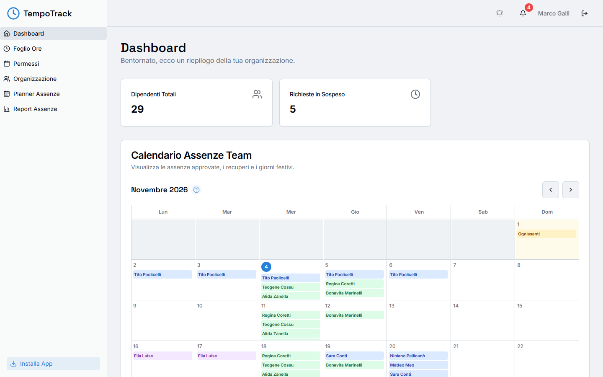
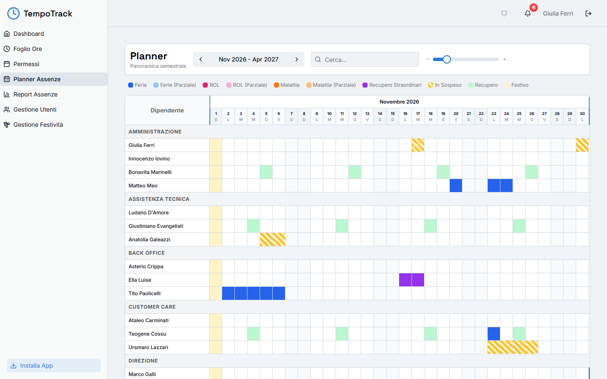
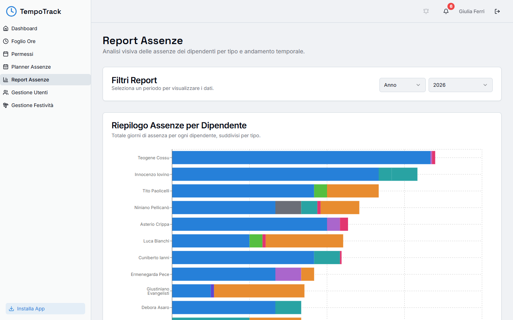
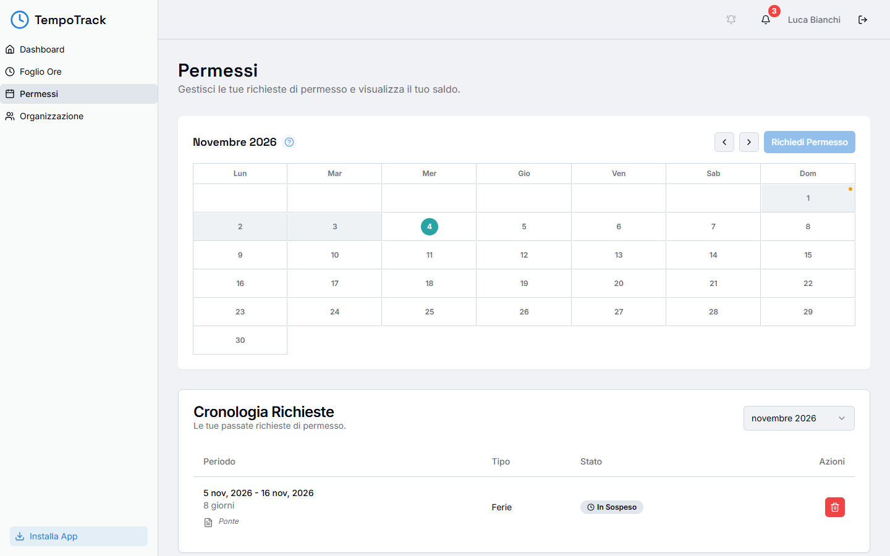
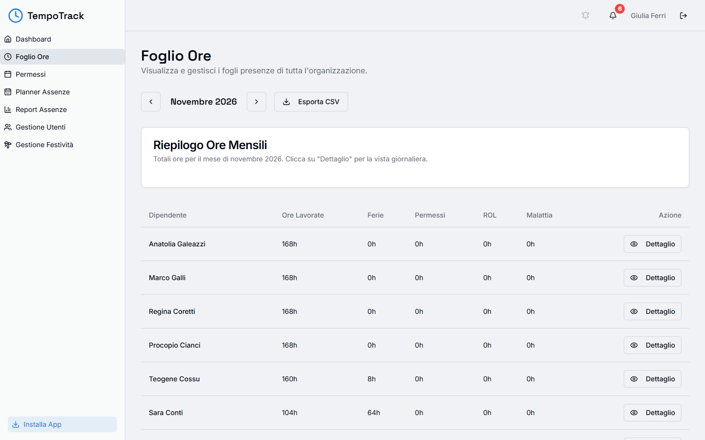
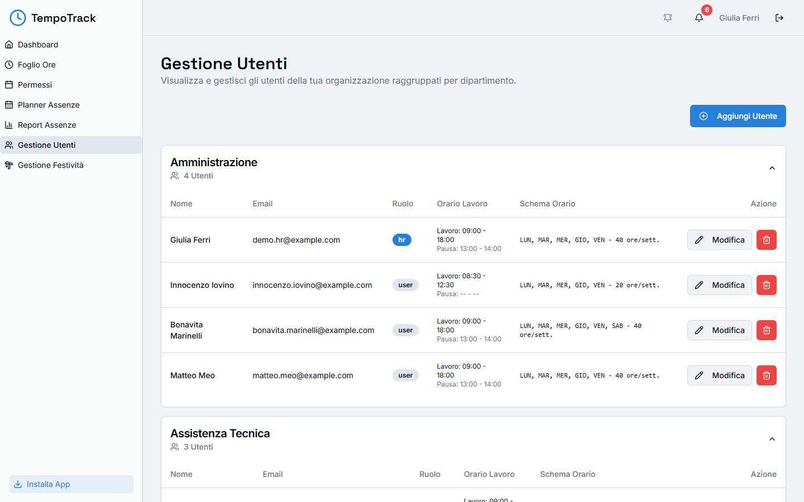
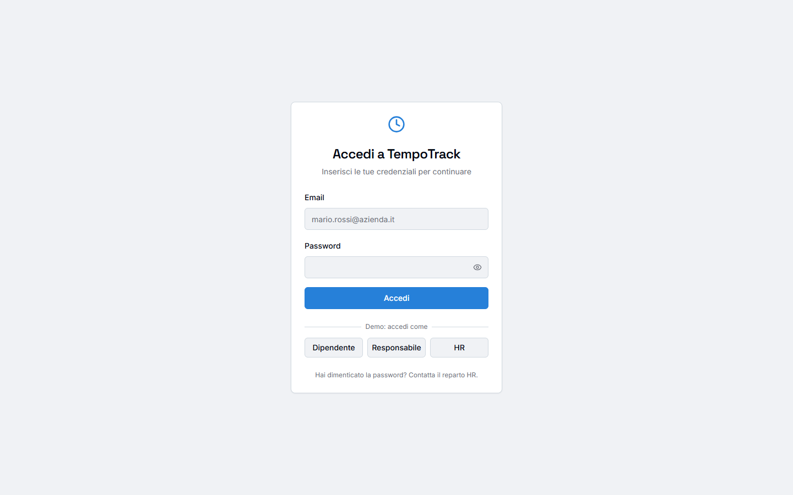
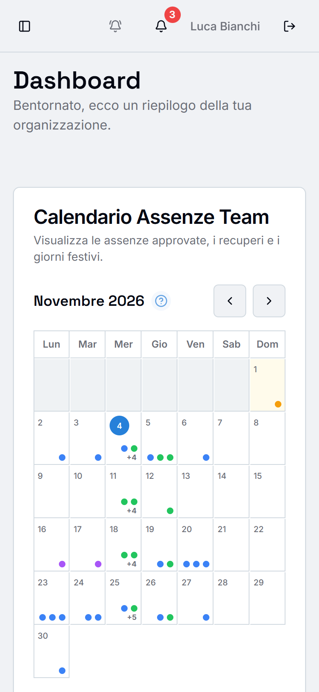
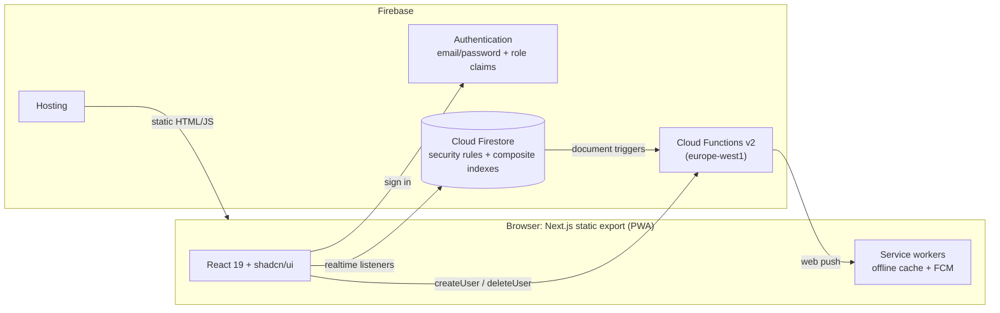

<div align="center">


# TempoTrack

**An HR Progressive Web App for leave requests, approvals, team planning and timesheets, built for Italian companies.**

[**Live demo**](https://tempotrack-demo.web.app) · [Features](#features) · [Architecture](#architecture) · [Run locally](#getting-started)




</div>

---

## Try it

Open **[tempotrack-demo.web.app](https://tempotrack-demo.web.app)** and sign in with one click. No account is needed.

| Button | Role | What to try |
|---|---|---|
| **Dipendente** | Employee | Request leave on the calendar, see your history and timesheet |
| **Responsabile** | Department manager | Approve or reject requests from the dashboard, browse the planner and reports |
| **HR** | HR administrator | Everything above, plus user management and company holidays |

> The interface is in Italian, like the original product. Every person and number in the demo is fake (see [Demo data](#demo-data)). The demo is shared, so other visitors may have changed things.

## About this project

TempoTrack replaced spreadsheets and email threads for managing staff absences at an Italian company. Employees request time off from their phone, managers approve it in one tap, and HR sees who is off, and why, across every department.

This repository is a **sanitized portfolio copy**. All company data, credentials and project identifiers were removed. The app runs against a separate demo Firebase project, filled by a reproducible [seed script](scripts/seed.mjs).

## Features

<table>
<tr>
<td width="50%" valign="top">

**Time off** (`/time-off`)<br/>
Pick days on a calendar and request full or partial days, choosing from 17 leave types that follow Italian labour rules (Ferie, ROL, Malattia, Legge 104, ...). The app blocks requests that overlap an existing one.

**Approvals**<br/>
Pending requests go to HR and to the admins of the employee's department. Approve or reject them straight from the dashboard.

**Absence planner** (`/planner`)<br/>
A six-month grid for every department: leave by type, pending requests, compensatory days and holidays, with search and zoom.

</td>
<td width="50%" valign="top">

**Timesheets** (`/timesheets`)<br/>
Monthly planned and actual hours per person, from their work schedule, partial-day holidays, leave and weekly compensatory time. Exportable to CSV.

**Reports** (`/reports`)<br/>
Absence breakdown by employee and type, per month or year (Recharts).

**HR administration** (`/users`, `/festivita`)<br/>
Work schedules, roles, the departments each manager handles, and company holidays: national, department-only and partial-day closures.

</td>
</tr>
</table>

Also included: an **installable PWA** with an offline page and Firestore offline persistence, an in-app **notification centre**, **FCM web push** through Cloud Functions, a **birthday calendar** and a **mobile-first** layout.

### Screenshots

| Absence planner (HR) | Reports |
|---|---|
|  |  |
| **Time-off requests (employee)** | **Timesheets** |
|  |  |
| **User management** | **Login with demo accounts** |
|  |  |

<p align="center"></p>

## Roles and permissions

| | Employee (`user`) | Manager (`admin`) | HR (`hr`) |
|---|:-:|:-:|:-:|
| Request leave, see own history and timesheet | ✅ | ✅ | ✅ |
| Team calendar (approved absences, holidays) | ✅ | ✅ | ✅ |
| Approve or reject requests | | Own departments | All |
| Planner and reports | | ✅ | ✅ |
| Users, schedules and holidays | | | ✅ |

The role lives in two places. A **Firebase Auth custom claim** is checked by Cloud Functions, and the **user document** is checked by [Firestore security rules](firestore.rules). The rules enforce access on the server, so a modified client cannot read or change other people's requests.

## Architecture



**Key decisions**

- **Static export plus a client-side Firebase SDK.** Every page is client-rendered against Firestore real-time listeners, so the build is plain static files on Firebase Hosting. There is no server to run or pay for.
- **Firestore offline persistence** (`persistentLocalCache`) keeps the app usable on a weak connection, and the service worker caches the app shell.
- **Cloud Functions handle anything that must not be trusted to the client:** creating users with role claims, routing push notifications to the right approvers, and a scheduled job that archives old requests and notifications each year.
- **Configuration as code.** `firebase.json` declares the database location, rules, indexes, auth providers and hosting security headers (Content-Security-Policy, X-Frame-Options, nosniff, Referrer-Policy). A fresh project is one `firebase deploy` away.

### Data model

| Collection | Contents |
|---|---|
| `users/{uid}` | Profile, role, department, work schedule, weekly compensatory day, managed departments |
| `users/{uid}/compensatoryMoveRequests/{weekId}` | Requests to move the weekly compensatory day (`2026-W45`) |
| `timeOffRequests/{id}` | Dates, type, partial-day times, status (`In Sospeso` / `Approvato` / `Rifiutato`) |
| `holidays/{year}` | `dates[]`: national, department-only or partial-day closures |
| `notifications/{id}` | In-app notification centre |
| `archive_*` | Requests and notifications archived by the scheduled function |

## Tech stack

| Layer | Tools |
|---|---|
| Frontend | Next.js 16 (App Router, static export), React 19, TypeScript |
| UI | Tailwind CSS, shadcn/ui (Radix UI), lucide-react, Recharts |
| Forms and dates | react-hook-form, zod, date-fns (Italian locale) |
| Backend | Firebase Auth, Cloud Firestore, Cloud Functions v2, Cloud Messaging, Hosting |
| Tooling | pnpm, ESLint, Firebase Emulator Suite, `@faker-js/faker` seed |

## Getting started

### Prerequisites
- Node.js 20+ and pnpm
- Firebase CLI: `npm i -g firebase-tools`

### Option A: local emulators (no Firebase account)

Requires Java 21+ for the emulators.

```bash
pnpm install
(cd functions && npm install && npm run build)
cp .env.example .env.local
```

In `.env.local`, set:

```env
NEXT_PUBLIC_FIREBASE_API_KEY=demo-key
NEXT_PUBLIC_FIREBASE_PROJECT_ID=demo-tempotrack
NEXT_PUBLIC_FIREBASE_AUTH_DOMAIN=demo-tempotrack.firebaseapp.com
NEXT_PUBLIC_USE_FIREBASE_EMULATORS=true
NEXT_PUBLIC_DEMO_PASSWORD=choose-a-demo-password
```

Then, in two terminals:

```bash
pnpm emulators
```

```bash
pnpm seed:emulator && pnpm dev
```

Open http://localhost:3000 and use the **Demo: accedi come** buttons.

### Option B: your own Firebase project

```bash
firebase projects:create your-project-id
firebase apps:create web "TempoTrack Web" --project your-project-id
firebase apps:sdkconfig web <appId> --project your-project-id   # copy the values into .env.local
```

1. Put the project ID in `.firebaserc`.
2. Create Firestore (in `europe-west1`), deploy the rules and the 12 composite indexes, and enable Email/Password sign-in:
   ```bash
   firebase deploy --only firestore,auth
   ```
3. Download a service-account key (Project settings → Service accounts) and save it **outside the repository**. Then seed the data:
   ```bash
   GOOGLE_APPLICATION_CREDENTIALS=/path/to/key.json pnpm seed:reset
   ```
4. Build and publish:
   ```bash
   pnpm deploy:hosting
   ```

Hosting, Auth and Firestore all run on the free **Spark** plan. Cloud Functions (push notifications, adding and deleting users) need the **Blaze** plan. To deploy them, set `APP_URL` in `functions/.env` and run `firebase deploy --only functions`.

### Scripts

| Command | What it does |
|---|---|
| `pnpm dev` | Dev server on http://localhost:3000 |
| `pnpm build` | Static export into `out/` |
| `pnpm typecheck` / `pnpm lint` | TypeScript and ESLint |
| `pnpm seed` / `pnpm seed:reset` | Load demo data (`--reset` wipes it first) |
| `pnpm seed --dry-run` | Generate the data in memory and write it to `scripts/seed-preview.json` |
| `pnpm emulators` / `pnpm seed:emulator` | Local Firebase emulators and seeding them |
| `pnpm deploy:hosting` | Build and deploy to Firebase Hosting |

## Demo data

[`scripts/seed.mjs`](scripts/seed.mjs) uses `@faker-js/faker` (Italian locale, fixed seed) to generate the same realistic dataset on every run:

- **29 people** in 8 departments, including the 3 demo accounts, with full-time, part-time and six-day schedules
- **About 160 time-off requests** over 6 past and 3 future months, in every status and with no overlaps per person. Sick leave only falls in the past, and no request is "created" in the future.
- **Italian holidays**, with Easter Monday computed for each year, plus department-only and partial-day closures
- **Compensatory-day moves** and **notifications**

Every email address uses the reserved `example.com` domain. The demo password comes from `NEXT_PUBLIC_DEMO_PASSWORD`. It ships to the browser by design, so use it only for demo accounts. In demo mode, creating and deleting users is turned off so visitors can't remove the shared logins.

## Project structure

```
src/
  app/                 # pages: time-off, planner, timesheets, reports, users, festivita, ...
  components/          # feature components (calendars, forms, notifications)
    ui/                # shadcn/ui primitives
  hooks/               # push notifications, online status, mobile breakpoint
  lib/                 # Firebase init, constants, notification helpers
functions/src/         # Cloud Functions: triggers, callables, scheduled archive job
public/                # PWA manifest, service workers, icons
scripts/seed.mjs       # demo data generator
firestore.rules        # security rules
firestore.indexes.json # composite indexes
docs/screenshots/      # README images
```

## Limitations

- **Push notifications and adding or deleting users** need Cloud Functions, so they are inactive in the free-tier demo.
- **Decisions don't create in-app notifications** for the employee yet; they arrive by push only.
- The **demo is shared and public**, so the data is periodically reset with `pnpm seed:reset`.

---

<div align="center">
Built by <a href="https://github.com/AleVassman">@AleVassman</a>
</div>
